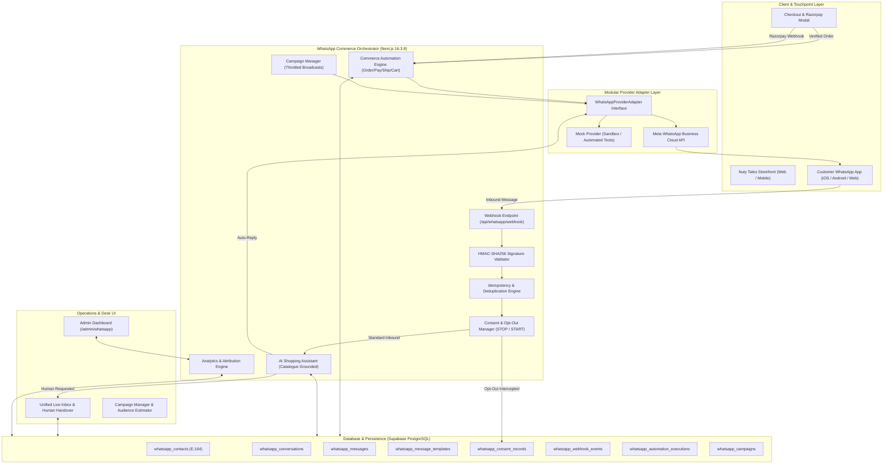

# NUTY TALES — WHATSAPP COMMERCE OS: SYSTEM ARCHITECTURE SPECIFICATION
**System:** Nuty Tales WhatsApp Commerce OS  
**Author:** Antigravity System Architecture Specialist  
**Target Enterprise:** Nuty Tales (https://nutytales.com)  
**Date:** 2026-10-30  
**Version:** 1.0.0 (Production Release)

---

## 1. ARCHITECTURAL OBJECTIVES & CONSTRAINTS

1. **Commerce-Centric Integration:**
   Exclusively built for Nuty Tales e-commerce operations, dry fruits retail, wholesale supply, wedding hampers, and corporate gifting.
2. **Meta WhatsApp Business Platform (Cloud API):**
   Prioritizes the official Meta Graph API v21.0+ for all transactional utility templates, payment receipts, order dispatches, and compliant marketing broadcasts.
3. **Provider-Agnostic Adapter Pattern:**
   Business workflows and customer state are decoupled from third-party transport layers. The system seamlessly supports Meta Cloud API, sandbox mock providers, and future enterprise aggregators without altering business logic.
4. **Vercel Serverless & Edge Resilient:**
   Zero dependency on stateful daemon WebSockets. Built with stateless HTTP microservices, asynchronous execution, and database-backed idempotency.
5. **Non-Blocking Reliability:**
   Customer checkout and Razorpay payment flows never block on WhatsApp network calls. If the messaging provider undergoes latency or outage, order completion is preserved 100%.

---

## 2. SYSTEM TOPOLOGY & ARCHITECTURE DIAGRAM



---

## 3. CORE SUB-SYSTEMS & RESPONSIBILITIES

### 3.1 Modular Provider Adapter (`src/lib/whatsapp/provider/`)
- **`WhatsAppProviderAdapter`:** Abstract interface defining `sendTextMessage`, `sendTemplateMessage`, `sendInteractiveMessage`, `verifyWebhookSignature`, `parseWebhookPayload`, and `getHealthStatus`.
- **`MetaCloudApiAdapter`:** Implements Meta Graph API v21.0 HTTPS REST protocol. Dispatches official Interactive Quick Reply buttons and Category Templates (UTILITY, MARKETING). Verifies HMAC-SHA256 signatures via `crypto.timingSafeEqual`.
- **`MockWhatsAppProvider`:** Operates in test environments and offline sandboxes. Emulates 100% of Meta features, captures sent payloads in an in-memory queue, and generates synthetic WAMIDs for automated testing.
- **Provider Factory (`getWhatsAppProvider()`):** Automatically switches between live Meta Cloud API and Mock Sandbox based on environment variable availability (`META_WHATSAPP_PHONE_NUMBER_ID`, `META_WHATSAPP_ACCESS_TOKEN`).

### 3.2 Customer Directory & Phone Normalizer (`src/lib/whatsapp/phone.ts` & `db.ts`)
- Strict E.164 normalization for all incoming and checkout numbers.
- Handles standard Indian mobile numbers (10 digits starting with 6–9), leading zeros (`09717161809`), country code prefixes (`91`, `+91`), and international formats (+1, +971, +44).
- Maintains unified customer record with total orders, lifetime spend (₹), last order date, preferred language (English / Hindi), customer segment, and CRM notes.

### 3.3 Customer Consent & Opt-Out Suppression (`src/lib/whatsapp/consent.ts`)
- Zero-tolerance compliance with Meta Business Messaging Policy and Telecom regulations.
- Intercepts inbound regulatory keywords (`STOP`, `UNSUBSCRIBE`, `ROKO`, `BAND KARO`, `CANCEL`).
- Immediately updates contact status to `OPTED_OUT` and emits audit record into `whatsapp_consent_records`.
- Re-activation handled securely upon receiving explicit `START` or `SUBSCRIBE` keywords.
- Marketing campaigns strictly reject contacts with `OPTED_OUT` or `PENDING` status.
- Transactional Utility notifications (order confirmation, payment receipts, shipment tracking) continue to function for active orders.

### 3.4 Event-Driven Automation Engine (`src/lib/whatsapp/automations.ts`)
Executes asynchronous, non-blocking workflows for 6 primary commerce triggers:
1. **Order Confirmation:** Triggered by `/api/orders` upon verified checkout submission. Formats order items, total amount (₹), and live tracking URL. Enforces single execution via idempotency key `ORDER_CONFIRMATION_{orderId}`.
2. **Payment Confirmation:** Triggered by verified server-side Razorpay webhook or signature verification in `/api/razorpay/verify`. Never trusts browser redirects. Dispatches payment receipt with transaction ID.
3. **Shipment Dispatch:** Triggered when courier AWB is registered. Dispatches carrier name and tracking link.
4. **Delivery & Feedback:** Dispatches delivery confirmation and requests customer review score.
5. **Abandoned Cart Recovery:** Triggers after cart inactivity delay (60 min). Strictly enforces marketing consent check, dispatches approved discount incentive (`NUTY10`), and suppresses duplicate reminders for the same cart session.
6. **Repeat Purchase Nudge:** Triggers based on previous order history (30-day restock cycle) recommending fresh harvest batches.

### 3.5 Grounded AI Shopping Assistant (`src/lib/whatsapp/ai-assistant.ts`)
- Factual grounding in Nuty Tales product master (`src/lib/products-data.ts`), wedding hampers, and company policies.
- Native bilingual parsing and reply generation in English and Hindi.
- Answers queries regarding pricing, pack sizes (250g, 500g, 1kg, 2kg), B2B wholesale tiers (10kg–100kg), origins (Mithila, Kashmir, California), and FSSAI certification (#22724441000048).
- **Instant Human Escalation:** Inbound messages containing keywords like `agent`, `human`, `support`, `representative`, or complaints automatically flag the conversation as `HUMAN_TAKEOVER`, silencing AI auto-replies and routing to the staff desk.
- **Financial Safety Guardrail:** The AI assistant is programmatically prevented from executing refunds, altering prices, or making financial commitments autonomously.

### 3.6 Unified Administrative Inbox (`/admin/whatsapp`)
- Real-time desk interface matching Nuty Tales luxury branding (`#17233B`, `#C9A45C`, `#F7F2E8`).
- Conversation list with live search, status filters (All, Open, AI Active, Human Takeover, Resolved), and unread indicators.
- Complete message history showing customer inbound queries, AI automated replies, agent manual messages, and delivery ticks (sent, delivered, read, failed).
- Direct agent response composer and one-click AI/Human handover toggle.

### 3.7 Campaign Manager & Audience Estimator (`src/lib/whatsapp/campaigns.ts`)
- Promotional broadcast wizard supporting dry fruits, Kashmiri saffron/honey, and wedding hamper campaigns.
- Live audience preview calculating eligible opted-in recipients vs suppressed opt-outs.
- Cost estimator calculating Meta Cloud API fees (~₹0.88/marketing conversation in India) and projected revenue ROI.
- Safe execution engine with batch throttling.

---

## 4. INBOUND WEBHOOK PROCESSING PIPELINE

```
Inbound HTTP POST from Meta (https://nutytales.com/api/whatsapp/webhook)
   │
   ├─► 1. Verify HMAC-SHA256 Signature (x-hub-signature-256 vs META_APP_SECRET)
   │      └─ If invalid: Return HTTP 401 Unauthorized
   │
   ├─► 2. Check Event Idempotency in whatsapp_webhook_events
   │      └─ If duplicate event ID / WAMID: Return HTTP 200 OK (already processed)
   │
   ├─► 3. Parse Payload via Adapter
   │      ├─ Status Callbacks: Update whatsapp_messages (DELIVERED / READ / FAILED)
   │      └─ Inbound Messages: Continue to Step 4
   │
   ├─► 4. Evaluate Consent Keywords (STOP / START / UNSUBSCRIBE)
   │      ├─ If STOP: Mark OPTED_OUT, log audit record, send confirmation, exit
   │      └─ If START: Mark OPTED_IN, log audit record, send confirmation, exit
   │
   ├─► 5. Upsert Customer Contact & Active Conversation
   │      └─ Normalize E.164 phone, merge interaction history
   │
   ├─► 6. Record Inbound Message in whatsapp_messages
   │
   ├─► 7. Conversation Status Check
   │      ├─ If status == 'HUMAN_TAKEOVER': Leave for human agent in Inbox, exit
   │      └─ If status == 'OPEN' or 'AI_ACTIVE': Run AI Shopping Assistant
   │
   ├─► 8. AI Shopping Assistant Execution
   │      ├─ Check catalogue & intent (Makhana, Almonds, Hampers, Order Tracking)
   │      ├─ Check for human escalation trigger -> Switch status to HUMAN_TAKEOVER
   │      ├─ Generate bilingual reply (English / Hindi)
   │      └─ Dispatch reply via WhatsApp Provider & log outbound message
   │
   └─► 9. Return HTTP 200 OK to Meta
```

---

## 5. REVENUE ATTRIBUTION & ANALYTICS MODEL

To support the Nuty Tales business target of ₹10 Lakh monthly sales, the Analytics Engine (`src/lib/whatsapp/analytics.ts`) tracks:
- **Direct Order Attribution:** Orders placed by contacts within 72 hours of receiving an automated order notification, abandoned cart recovery message, or promotional campaign.
- **Conversion Rate:** Total attributed orders divided by total contacted WhatsApp leads.
- **Average Order Value (AOV):** Total attributed revenue divided by total attributed orders.
- **Campaign ROI Multiple:** Attributed gross revenue divided by estimated Meta messaging costs.
- **CSV Data Export:** One-click downloadable report for accounting and investor reporting.
