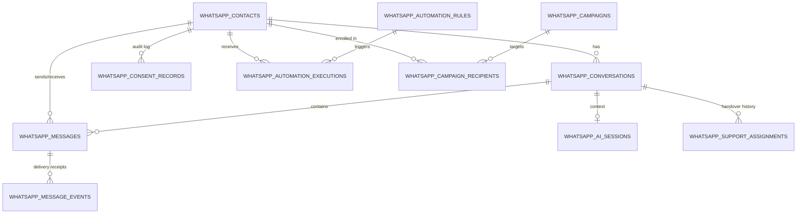

# NUTY TALES — WHATSAPP COMMERCE OS: DATABASE DESIGN & SCHEMA SPECIFICATION
**System:** WhatsApp Commerce Database Engine  
**Target Enterprise:** Nuty Tales (https://nutytales.com)  
**Database:** Supabase PostgreSQL (`qezkjbzmtfjjmqgzgili.supabase.co`)  
**Migration:** `supabase/migrations/005_whatsapp_commerce_os.sql`  
**Date:** 2026-10-30  
**Version:** 1.0.0 (Production Schema)

---

## 1. DESIGN PRINCIPLES & CONSTRAINTS

1. **Idempotence & Non-Destructive Migrations:**
   All table creations, indexes, and policy definitions use `IF NOT EXISTS` and `ON CONFLICT DO NOTHING`. Existing application tables (`users`, `leads`, `wedding_hampers`, `orders`, `profiles`) remain completely intact.
2. **Strict Foreign Key Constraints & Data Integrity:**
   Foreign keys link conversations and messages to `whatsapp_contacts(id)`, with `ON DELETE CASCADE` on message/conversation chains and `ON DELETE SET NULL` for user profiles.
3. **Audit Trail & Regulatory Telemetry:**
   Consent updates are stored in `whatsapp_consent_records` as immutable point-in-time entries capturing IP, user agent, source, and timestamps.
4. **Row-Level Security (RLS) & Isolation:**
   All 14 WhatsApp tables have RLS enabled. Direct public access is disabled. Privileged backend APIs use `service_role` bypass policies.
5. **Deduplication & Idempotency:**
   Unique constraints on `whatsapp_webhook_events(event_id)` and `whatsapp_automation_executions(idempotency_key)` prevent duplicate order confirmations, double payments alerts, or replay attacks.

---

## 2. ENTITY RELATIONSHIP ARCHITECTURE



---

## 3. TABLE DICTIONARY & SPECIFICATIONS

### 3.1 `whatsapp_provider_config`
Stores runtime credentials and operational parameters for Meta WhatsApp Cloud API.
- `id` (TEXT, PK): Primary configuration key (`primary_meta_config`).
- `provider` (TEXT): Active driver (`meta_cloud_api`, `mock_sandbox`, `baileys_experimental`).
- `phone_number_id` (TEXT): Meta Phone Number ID.
- `waba_id` (TEXT): WhatsApp Business Account ID.
- `business_phone` (TEXT): E.164 business number (`+919717161809`).
- `access_token_masked` (TEXT): Audit-safe masked token reference.
- `app_secret_masked` (TEXT): Audit-safe masked secret reference.
- `webhook_verify_token` (TEXT): Callback verification token.
- `rate_limit_per_second` (INTEGER): Rate throttling threshold (default: 25 msgs/sec).

### 3.2 `whatsapp_contacts`
The authoritative customer registry for WhatsApp communication.
- `id` (TEXT, PK): Formatted ID (`WAC-XXXXXX`).
- `phone_number` (TEXT, UNIQUE): E.164 formatted number (`+919717161809`).
- `formatted_phone` (TEXT): Display string (`+91 97171 61809`).
- `name` (TEXT): Customer full name.
- `email` (TEXT): Optional customer email.
- `user_id` (TEXT, FK): References `public.profiles(id)` if logged in.
- `segment` (TEXT): Classification (`new_customer`, `first_time_buyer`, `repeat_customer`, `high_value`, `inactive`, `abandoned_checkout`, `wedding_gifting`, `wholesale`).
- `preferred_language` (TEXT): `en` or `hi`.
- `total_orders` (INTEGER): Total verified orders placed.
- `total_spend` (NUMERIC): Cumulative order value in INR.
- `last_order_id` (TEXT): Reference to most recent order ID.
- `last_order_at` (TIMESTAMPTZ): Timestamp of last purchase.
- `consent_status` (TEXT): `OPTED_IN`, `OPTED_OUT`, `PENDING`.
- `consent_timestamp` / `opt_out_timestamp` (TIMESTAMPTZ): Compliance dates.
- `tags` (TEXT[]): Flexible categorization tags.

### 3.3 `whatsapp_conversations`
Tracks continuous chat threads and customer service assignment.
- `id` (TEXT, PK): Formatted session ID (`WACV-XXXXXX`).
- `contact_id` (TEXT, FK): References `whatsapp_contacts(id)`.
- `status` (TEXT): `OPEN`, `AI_ACTIVE`, `HUMAN_TAKEOVER`, `RESOLVED`, `ARCHIVED`.
- `priority` (TEXT): `LOW`, `NORMAL`, `HIGH`, `URGENT`.
- `assigned_to` (TEXT): Staff email or representative ID.
- `unread_count` (INTEGER): Number of customer messages unread by staff.
- `last_message_preview` (TEXT): Snippet for rapid inbox scanning.
- `last_message_at` (TIMESTAMPTZ): Ordering timestamp for inbox threads.

### 3.4 `whatsapp_messages`
The immutable ledger of all inbound and outbound messages.
- `id` (TEXT, PK): Unique record identifier (`WAM-XXXXXXX`).
- `conversation_id` (TEXT, FK): References `whatsapp_conversations(id)`.
- `contact_id` (TEXT, FK): References `whatsapp_contacts(id)`.
- `meta_message_id` (TEXT, UNIQUE): Meta WAMID (`wamid.HBgL...`).
- `direction` (TEXT): `INBOUND` or `OUTBOUND`.
- `sender_type` (TEXT): `CUSTOMER`, `AI`, `AGENT`, `SYSTEM`.
- `message_type` (TEXT): `text`, `template`, `image`, `interactive`.
- `body` (TEXT): Full message body.
- `template_name` (TEXT): Template identifier if applicable.
- `delivery_status` (TEXT): `PENDING`, `SENT`, `DELIVERED`, `READ`, `FAILED`.
- `error_code` / `error_message` (TEXT): Failure diagnostics from Meta.

### 3.5 `whatsapp_consent_records`
Regulatory audit log for TRAI / Meta policy compliance.
- `id` (TEXT, PK): `CNS-XXXXXX`.
- `contact_id` (TEXT, FK): References `whatsapp_contacts(id)`.
- `phone_number` (TEXT): Normalized recipient phone.
- `consent_type` (TEXT): `OPT_IN` or `OPT_OUT`.
- `source` (TEXT): Origin channel (`checkout_checkbox`, `chat_keyword`, `admin_override`).
- `ip_address` / `user_agent` (TEXT): Verification evidence.
- `recorded_at` (TIMESTAMPTZ): Exact timestamp.

### 3.6 `whatsapp_automation_rules` & `whatsapp_automation_executions`
Commerce event automation rules and execution tracking for idempotency.
- Execution idempotency key prevents duplicate triggers (e.g. `ORDER_CONFIRMATION_NT-ORD-2026-102938`, `PAYMENT_CAPTURED_pay_2948293`).
- Tracks trigger event, entity ID, execution timestamp, and message link.

### 3.7 `whatsapp_campaigns` & `whatsapp_campaign_recipients`
Promotional broadcasts, audience preview counts, delivered/read metrics, and conversion revenue attribution.

### 3.8 `whatsapp_webhook_events`
Meta webhook deduplication ledger ensuring replayed payloads or HTTP retries are handled with 100% idempotency.

---

## 4. ROW-LEVEL SECURITY & ACCESS POLICIES

```sql
-- RLS Activation on all tables
ALTER TABLE public.whatsapp_contacts ENABLE ROW LEVEL SECURITY;
ALTER TABLE public.whatsapp_messages ENABLE ROW LEVEL SECURITY;
ALTER TABLE public.whatsapp_conversations ENABLE ROW LEVEL SECURITY;

-- Backend Service Role Bypass (Privileged Server API Execution)
CREATE POLICY "whatsapp_contacts_service_role" ON public.whatsapp_contacts
  FOR ALL TO service_role USING (true) WITH CHECK (true);

CREATE POLICY "whatsapp_messages_service_role" ON public.whatsapp_messages
  FOR ALL TO service_role USING (true) WITH CHECK (true);
```
Public browser anon keys cannot execute SELECT, INSERT, UPDATE, or DELETE on WhatsApp tables, preventing unauthorized customer phone number or conversation leakage.
